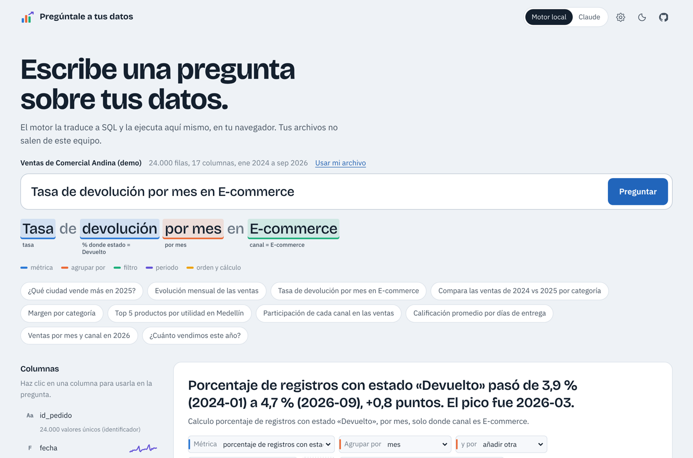
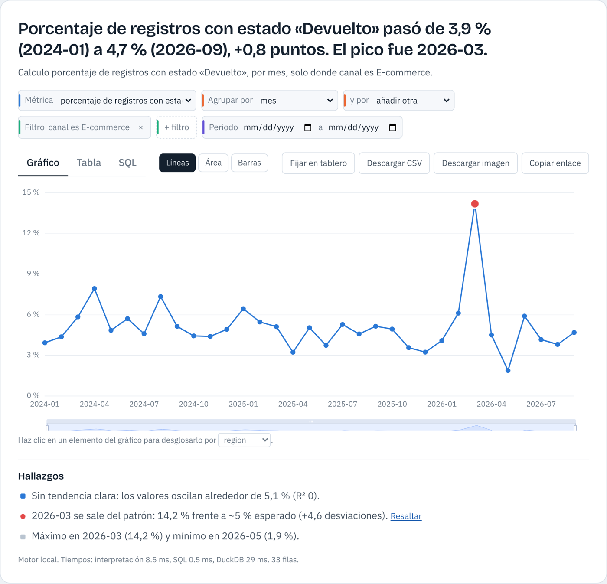
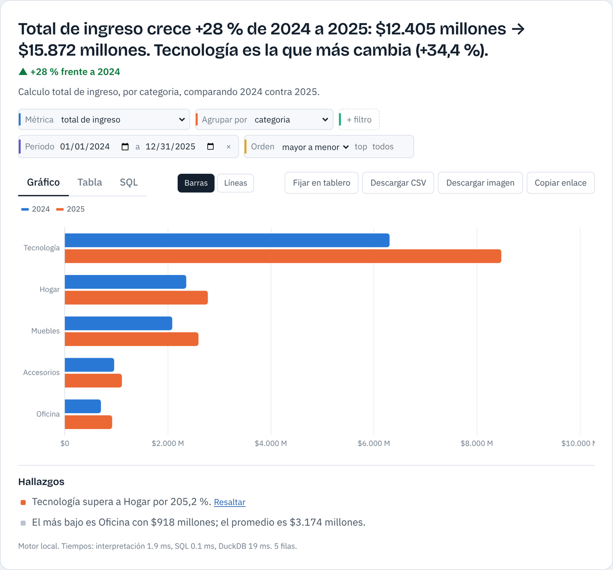
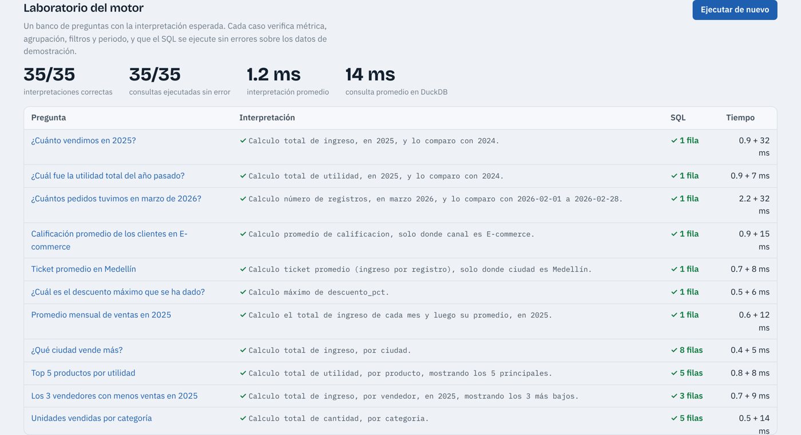

# Pregúntale a tus datos

Haz preguntas en español sobre cualquier tabla (CSV, Excel, JSON o Parquet) y obtén la respuesta, el SQL, un gráfico y hallazgos automáticos. Todo corre en el navegador con DuckDB-WASM: los archivos no salen del equipo.

**[Abrir la demo](https://johnbyrona.github.io/preguntale-a-tus-datos/)**



## Qué resuelve

En cualquier empresa hay alguien que necesita un dato y depende de que otra persona escriba la consulta. Esta herramienta convierte una pregunta como «¿qué ciudad vende más en 2025?» en SQL, la ejecuta y explica el resultado. No está atada a un sector: entiende la tabla que le cargues a partir de sus columnas y sus valores.

## Lo que hace

- **Entiende la pregunta y lo muestra.** Cada fragmento se anota con su papel: métrica, agrupación, filtro, periodo o cálculo. Si algo se interpretó mal, se ve de inmediato.
- **Lenguaje de negocio en español.** Sinónimos («ventas», «facturación» → ingreso), valores reales de la tabla («Medellín», «E-commerce»), exclusiones («excepto Bogotá»), comparadores («más de 10 unidades», «descuento mayor al 15 %») y fechas («últimos 3 meses», «primer semestre de 2025», «este año vs el año pasado»).
- **Cálculos que se piden a diario:** totales, promedios, medianas, conteos distintos, top N, participación en el total, variación contra el periodo anterior, acumulados, tasas («tasa de devolución»), márgenes y promedio mensual.
- **Intención editable.** Métrica, agrupación, filtros, periodo y orden se pueden cambiar con controles sin reescribir la pregunta. El SQL también se puede editar y ejecutar.
- **Gráfico según la forma del resultado:** cifra con tendencia mensual, barras, líneas, área, mosaico y mapa de calor, en modo claro y oscuro.
- **Desglose con un clic.** Al hacer clic en una barra o un mes, se filtra y se abre por otra dimensión, con ruta de regreso.
- **Hallazgos automáticos:** tendencia por regresión lineal, valores atípicos sobre los residuos, estacionalidad, concentración tipo Pareto y brechas entre categorías.
- **Tablero propio** con las respuestas fijadas, exportación a CSV e imagen y enlaces que abren la demo con una pregunta.
- **Modo Claude opcional.** Con una clave propia de la API de Anthropic, las preguntas más libres se envían a Claude junto con el esquema (nunca las filas). Si el SQL falla, el error se le devuelve para que lo corrija.

| Valor atípico detectado | Comparación entre años |
| --- | --- |
|  |  |

## Cómo funciona

1. **Perfil del esquema.** Al cargar un archivo, DuckDB obtiene tipos, rangos, nulos, valores frecuentes e histogramas de cada columna (`src/app/db.js`).
2. **Vocabulario.** Con ese perfil se arma el vocabulario del motor: nombres de columnas y sus variantes, conceptos de negocio y valores reales (`buildVocabulary` en `src/engine/nl2sql.js`).
3. **Anotación.** La pregunta se normaliza conservando posiciones y se buscan coincidencias de tiempo, comparadores, límites, columnas y valores; los solapamientos se resuelven por longitud y prioridad.
4. **Intención → SQL.** La intención estructurada se traduce a SQL de DuckDB legible, con funciones de ventana para participación, variación y acumulados.
5. **Resultado.** La consulta corre en DuckDB-WASM; luego se eligen gráfico, frase de respuesta y hallazgos.

El motor local no usa IA ni servicios externos. Las fechas relativas («este año») se calculan contra la última fecha de los datos, así la demo responde siempre igual.

## Pruebas

El banco de pruebas (`src/engine/evalset.js`) tiene 35 preguntas con la interpretación esperada. Corre en CI con DuckDB nativo y también en vivo desde la sección «Laboratorio» de la demo.

```bash
npm install
npm test          # interpretación + ejecución real del SQL
```



## Ejecutar en local

Es un sitio estático, sin compilación.

```bash
npm start                     # http://localhost:8080
npm run vendor                # opcional: copia las librerías a /vendor
# y abre http://localhost:8080/?local=1 para usarla sin CDN
```

Los datos de demostración se regeneran con `npm run data` (Python con pandas y numpy). Son sintéticos, de una empresa ficticia, e incluyen patrones a propósito: crecimiento, estacionalidad de fin de año y un pico anómalo de devoluciones en E-commerce en marzo de 2026.

## Estructura

```
index.html            página de la demo
assets/               estilos, fuentes e íconos
src/engine/           motor (sin dependencias del navegador, se prueba en Node)
  nl2sql.js           vocabulario, interpretación, SQL y explicación
  time.js             expresiones de tiempo en español
  text.js             normalización, números y plurales
  format.js           formato es-CO y frase de respuesta
  insights.js         hallazgos automáticos
  evalset.js          banco de pruebas
src/app/              interfaz, DuckDB-WASM, ECharts y modo Claude
scripts/              generación de datos y copia de librerías
tests/                pruebas con node:test
```

## Tecnologías

DuckDB-WASM, ECharts, SheetJS, JavaScript sin framework, Node para pruebas y Python para los datos sintéticos.

## Autor

John Byron Alzate Hernández, analista de datos en Medellín. [GitHub](https://github.com/johnbyronA)

Licencia MIT.
